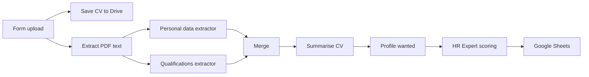

# AI CV Screening and Scoring

Candidates upload a CV through a form. The workflow extracts personal data and skills, summarises the CV, scores it against the wanted profile with Gemini, and saves the result to Google Sheets.

Built on an n8n community template and extended with Gemini models and Google Sheets scoring output.

## How it works

1. An n8n form collects the CV as a PDF. The file is stored in Google Drive.
2. The PDF text is extracted. Two information extractors pull out personal data and qualifications.
3. A summarisation chain writes a short profile of the candidate.
4. The "Profile Wanted" node holds the role requirements. The HR Expert chain compares them with the CV and returns a score and comment through a structured output parser.
5. The candidate data, summary and score are appended to Google Sheets.

## Integrations

- n8n Form Trigger, Google Drive, Google Sheets
- Google Gemini (chat model for all chains)

## Setup

1. Import `workflow.json` into n8n.
2. Create credentials for Google Drive, Google Sheets and Google Gemini, then select them in the nodes.
3. Replace these placeholders: `{{GOOGLE_DRIVE_ID}}`, `{{GOOGLE_DRIVE_FOLDER_ID}}`, `{{GOOGLE_SHEET_ID}}`.
4. Edit the "Profile Wanted" node to describe the role you are hiring for.

## Possible improvements

- Read the wanted profile from a sheet so one workflow can serve several roles.
- Send a short email to the candidate when the CV is received.
