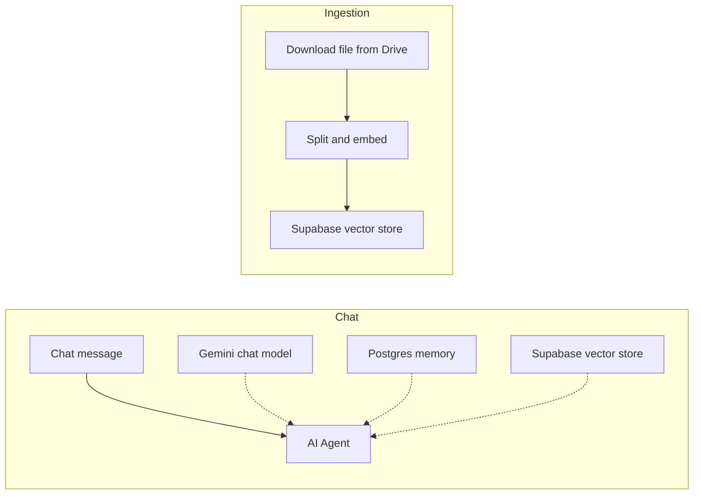

# RAG Chatbot with Supabase and Postgres

A chat agent that answers questions from your own documents. Documents are stored as embeddings in Supabase, and chat history is kept in Postgres so the agent remembers the conversation.

## How it works

1. **Ingestion:** a file is downloaded from Google Drive, split into chunks, embedded with Gemini embeddings and inserted into Supabase.
2. **Chat:** the n8n chat trigger sends each message to an AI Agent. The agent uses Gemini as the model, Postgres for chat memory, and the Supabase vector store as a retrieval tool.

## Integrations

- n8n Chat Trigger
- Google Gemini (chat and embeddings)
- Supabase vector store, Postgres chat memory
- Google Drive

## Setup

1. Import `workflow.json` into n8n.
2. Create credentials for Google Gemini, Supabase, Postgres and Google Drive, then select them in the nodes.
3. Create the `documents` table and match function in Supabase (see the n8n Supabase vector store docs).
4. Replace the placeholder `{{GOOGLE_DRIVE_FILE_ID}}`. Run the ingestion branch once, then open the chat.

## Possible improvements

- Add a trigger to the ingestion branch (Drive "file created" or a manual trigger). It currently has none.
- Ingest a whole folder instead of a single file.
