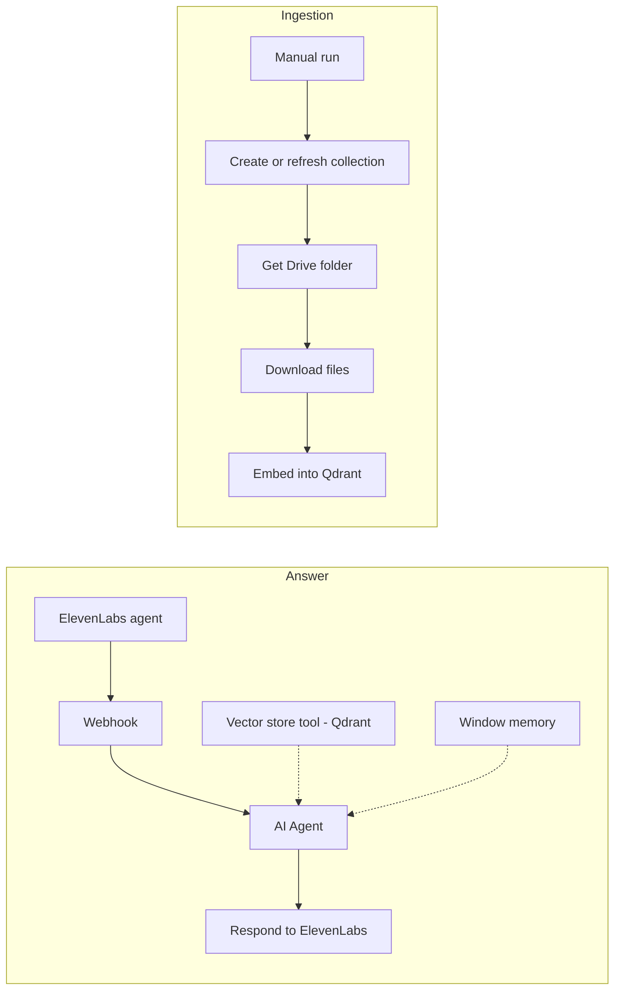

# Voice RAG Chatbot with ElevenLabs

A voice assistant built with an ElevenLabs conversational agent. When the caller asks a question, ElevenLabs calls an n8n webhook. An AI agent answers from a Qdrant knowledge base built from Google Drive documents.

Built on an n8n community template and extended with Google Drive ingestion and custom prompts.

## How it works

1. **Ingestion:** a manual run creates or clears the Qdrant collection. It then downloads every file in a Google Drive folder, splits it into tokens, embeds it with OpenAI and stores it in Qdrant.
2. **Answer:** the ElevenLabs agent sends the caller's question to the `Listen` webhook.
3. The AI Agent (OpenAI chat model with window memory) searches Qdrant through a vector store tool and writes a short spoken answer.
4. The answer is returned to ElevenLabs, which speaks it to the caller.

## Integrations

- ElevenLabs Conversational AI
- OpenAI (chat model and embeddings)
- Qdrant vector database
- Google Drive

## Setup

1. Import `workflow.json` into n8n.
2. Create credentials for OpenAI, Qdrant and Google Drive, then select them in the nodes.
3. Replace these placeholders: `{{QDRANT_URL}}`, `{{QDRANT_COLLECTION}}`, `{{ELEVENLABS_AGENT_ID}}`.
4. In ElevenLabs, add a webhook tool that calls the `Listen` webhook URL with the user question.
5. Run the ingestion branch once, then activate the workflow.

## Possible improvements

- Trigger ingestion automatically when a Drive file changes.
- Add a fallback answer when no relevant document is found.
