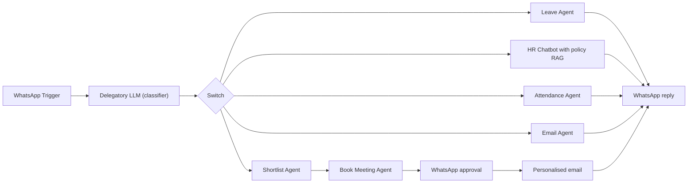

# WhatsApp HR Assistant Multi-Agent System

An HR assistant that runs on WhatsApp. An LLM classifies each message and sends it to the right agent: leave requests, HR policy questions, attendance, complaints, or candidate shortlisting with interview booking.

Built on an n8n community template and extended with custom prompts and integrations.

## How it works

1. The WhatsApp Trigger receives a message. A GPT-4o classifier decides the intent, and a Switch routes it to one of five branches.
2. **Leave:** the Leave Agent reads and updates leave balances in Google Sheets and emails the request.
3. **HR questions:** text, voice notes (Whisper transcription) and images (GPT-4o-mini vision) are turned into text. The HR Chatbot then answers from a Supabase vector store of company policy.
4. **Attendance:** a Code node checks the shared location against the office area. The Attendance Agent then logs check-in or check-out in Sheets.
5. **Complaints:** the Email Agent finds the department head and sends the complaint by Gmail.
6. **Shortlisting:** the Shortlist Agent compares applicants with the job description and reads each CV through a sub-workflow. It then saves a score to Sheets.
7. Shortlisted candidates go to the Book Meeting agent, which creates a Google Calendar slot. A WhatsApp approval step follows; after approval, a personalised invite is emailed.
8. Every branch replies to the employee on WhatsApp.

## Integrations

- WhatsApp Cloud API (trigger, media, send-and-wait approval)
- OpenAI: GPT-4o, GPT-4o-mini, GPT-4.1-nano, Whisper, vision, embeddings
- Supabase vector store
- Google Sheets, Gmail, Google Calendar

## Setup

1. Import `workflow.json` into n8n.
2. Create credentials for WhatsApp, OpenAI, Supabase, Google Sheets, Gmail and Google Calendar, then select them in each node.
3. Load your HR policy documents into a Supabase table for the `company_policy_vector_store` tool.
4. Replace these placeholders: `{{WHATSAPP_PHONE_NUMBER_ID}}`, `{{RECIPIENT_PHONE_NUMBER}}`, `{{GOOGLE_SHEET_ID}}`, `{{GOOGLE_CALENDAR_ID}}`, `{{GOOGLE_DRIVE_URL}}`, `{{CANDIDATE_EMAIL}}`.
5. Create the sheets used by the tools: leaves, attendance, department heads, job descriptions and applicants.

## Possible improvements

- Use one model per role consistently and keep model names in a single config node.
- Add an error branch that replies to the user when an agent fails.
- Split the shortlisting branch into its own workflow so it can run on a schedule.
