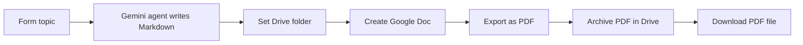

# AI Document to PDF Generator

Enter a topic in a form and get a finished multi-page PDF in Google Drive. Gemini writes the document in Markdown, Google Docs formats it, and Drive exports and archives the PDF.

## How it works

1. An n8n form collects the topic and details.
2. A Gemini agent writes a structured Markdown document.
3. An HTTP request uploads the Markdown to the Google Drive API as a Google Doc, which applies headings and formatting.
4. The Doc is downloaded as PDF and uploaded to the archive folder in Drive.
5. The final PDF is downloaded as binary, ready to share or attach.

## Integrations

- n8n Form Trigger
- Google Gemini
- Google Drive API (upload, convert, export)

## Setup

1. Import `workflow.json` into n8n.
2. Create credentials for Google Gemini and Google Drive, then select them in the nodes, including the HTTP "Create document file" node.
3. Replace the placeholder `{{GOOGLE_DRIVE_FOLDER_ID}}` in "Configure Google Drive Folder".

## Possible improvements

- Add a share step (email or Slack) at the end.
- Delete the temporary Google Doc after export.
