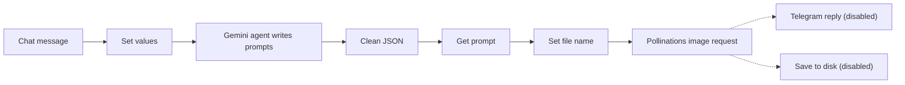

# AI Prompt to Image Generator

Turns a short idea typed in chat into detailed image prompts with Gemini, then generates the images for free with Pollinations.ai.

Built on an n8n community template and extended with Pollinations image generation and a Gemini prompt writer.

## How it works

1. The user sends an idea in the n8n chat.
2. A Gemini 2.0 Flash agent expands it into a detailed image prompt and returns JSON.
3. Code nodes clean the JSON, pick the prompt and build a file name.
4. An HTTP request to Pollinations.ai returns the image.
5. Optional outputs are included but disabled: a Telegram trigger and reply, and saving the image to disk.

## Integrations

- n8n Chat Trigger
- Google Gemini 2.0 Flash
- Pollinations.ai (image API, no key needed)
- Telegram and local file write (optional, disabled)

## Setup

1. Import `workflow.json` into n8n.
2. Create a Google Gemini credential and select it in the chat model node.
3. Optional: create a Telegram credential and enable the Telegram nodes, or enable "Save Image To Disk".

## Possible improvements

- Enable one output by default; right now the image is only visible in the execution log.
- Let the user choose the image size and style in the chat.
