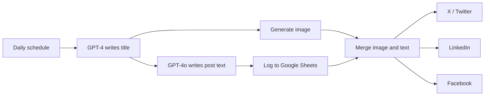

# AI Social Media Post Publisher

Runs once a day and publishes a new AI-written post with an AI-generated image to X (Twitter), LinkedIn and Facebook. Each post is also logged in Google Sheets.

Built on an n8n community template and extended with custom prompts and integrations.

## How it works

1. A schedule trigger runs every day at 22:00.
2. GPT-4 writes a post title. GPT-4o then writes the post text from that title.
3. The title and text are saved to Google Sheets.
4. In parallel, OpenAI generates an image for the title.
5. A Merge node (combine by position) joins the image and the text into one item, so each social node runs once per day.
6. The post is published to X, LinkedIn and Facebook.

## Integrations

- OpenAI (GPT-4, GPT-4o, image generation)
- Google Sheets
- X (Twitter), LinkedIn, Facebook Graph API

## Setup

1. Import `workflow.json` into n8n.
2. Create credentials for OpenAI, Google Sheets, X, LinkedIn and Facebook Graph API, then select them in the nodes.
3. Replace the placeholder `{{GOOGLE_SHEET_ID}}`.
4. Complete the LinkedIn and Facebook nodes: choose the person or page, and map the text and image from the Merge output.
5. Edit the first prompt to set your topic and tone.

## Possible improvements

- Add a review step (email or Slack approval) before publishing.
- Adapt the text length for each platform.
- Avoid repeating topics by reading recent titles from the sheet.
