# Multi-Agent SEO Blog Writer

A chain of AI agents that writes SEO blog posts for an online store. It researches the search results, picks internal links from the store sitemap, writes each section of the article, and saves the result to Google Docs.

Built on an n8n community template and extended with sitemap-based internal link selection and a URL selection agent.

## How it works

```mermaid
flowchart LR
    A[Webhook from Airtable] --> B[Get article data]
    B --> C[Read sitemap]
    C --> D[URL selection agent]
    D --> E["SERP research agent (Claude + Tavily)"]
    E --> F[Refine title]
    F --> G[Key takeaways]
    G --> H[Introduction]
    H --> I[Outline]
    I --> J[Main body]
    J --> K[Conclusion]
    K --> L[Google Doc + meta description]
    L --> M[Update Airtable]
```

1. An Airtable automation calls the webhook with the record ID of a new article.
2. The workflow loads the keyword and brief from Airtable.
3. It reads the store's `sitemap.xml` and its sub-sitemaps. A GPT-4.1-mini agent then picks 8-13 relevant internal links.
4. A Claude 3.5 Sonnet agent uses Tavily search to study the top results and returns keywords, insights and writing notes.
5. GPT-4o agents write the article step by step: refined title, key takeaways, introduction, outline, main body with internal links, and conclusion. Each step is saved back to Airtable.
6. A Drive folder and a Google Doc named after the title are created. The article and a generated meta description are added, and the folder is shared.

## Integrations

- Webhook, Airtable
- Tavily Search API
- Anthropic Claude 3.5 Sonnet, OpenAI GPT-4o and GPT-4.1-mini
- Google Drive, Google Docs, sitemap XML

## Setup

1. Import `workflow.json` into n8n.
2. Create credentials for Airtable, Anthropic, OpenAI, Google Drive and Google Docs, then select them in the nodes.
3. Create an Airtable base with the keyword research and article writer tables. Then fill the IDs in "Set Airtable Fields": `{{AIRTABLE_BASE_ID}}`, `{{AIRTABLE_TABLE_ID}}` and the `{{*_TABLE_ID}}` values.
4. Replace `{{TAVILY_API_KEY}}`, `{{STORE_DOMAIN}}`, `{{GOOGLE_DRIVE_FOLDER_ID}}` and `{{GOOGLE_SHEET_URL}}`.
5. Add an Airtable automation that calls the webhook (`/seo-blog-writer`) with the record ID.

## Possible improvements

- Make the output language and the store niche settings, instead of fixed text in each prompt.
- Connect or remove the unused article assembly, final edit and image prompt nodes.
- Move the Tavily key into an n8n credential instead of a header value.
