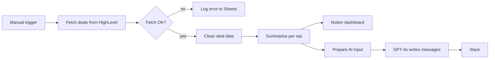

# AI Sales Leaderboard for HighLevel

Pulls all deals from HighLevel CRM, summarises results per sales rep, builds a Notion performance page, and posts AI-written motivational messages to Slack. Fetch errors are logged to Google Sheets.

Built on an n8n community template and extended with custom prompts and integrations.

## How it works

1. A manual trigger fetches all opportunities from HighLevel.
2. An If node checks the result. Errors are appended to a Google Sheets log.
3. Code nodes clean the deals and calculate total deals, total value, won deals and average value per rep.
4. A Notion page is created with the leaderboard.
5. Azure OpenAI GPT-4o writes a short motivational message for the team, which is sent to Slack.

## Integrations

- HighLevel CRM
- Azure OpenAI GPT-4o
- Notion, Slack, Google Sheets

## Setup

1. Import `workflow.json` into n8n.
2. Create credentials for HighLevel, Azure OpenAI, Notion, Slack and Google Sheets, then select them in the nodes.
3. Replace these placeholders: `{{NOTION_PAGE_ID}}`, `{{SLACK_USER_ID}}`, `{{GOOGLE_SHEET_ID}}`.

## Possible improvements

- Replace the manual trigger with a weekly schedule.
- Map rep IDs to names before building the leaderboard.
