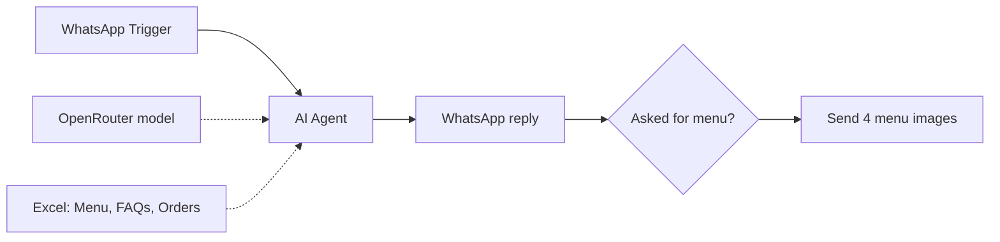

# WhatsApp Food Ordering Bot with Excel

A WhatsApp ordering bot for a restaurant that keeps its menu, FAQs and orders in Microsoft Excel (OneDrive). When a customer asks for the menu, it also sends the menu images.

## How it works

1. The WhatsApp Trigger receives a customer message.
2. The AI Agent (Grok 4 Fast via OpenRouter, with window memory) answers questions. It reads the menu and FAQs from Excel and appends confirmed orders to the Orders sheet.
3. The reply is sent on WhatsApp.
4. If the message contains "Menu", four menu images are sent one after another.

## Integrations

- WhatsApp Cloud API
- OpenRouter (x-ai/grok-4-fast)
- Microsoft Excel 365 (3 tools)

## Setup

1. Import `workflow.json` into n8n.
2. Create credentials for WhatsApp (trigger and send), OpenRouter and Microsoft Excel, then select them in the nodes.
3. Replace these placeholders: `{{EXCEL_WORKBOOK_ID}}`, `{{EXCEL_WORKSHEET_ID}}`, `{{MENU_IMAGE_URL_1}}` to `{{MENU_IMAGE_URL_4}}`.
4. Edit the agent prompt with your restaurant details.

## Possible improvements

- Connect or remove the unused MongoDB chat memory node (Simple Memory is active).
- Match "menu" without case sensitivity.
