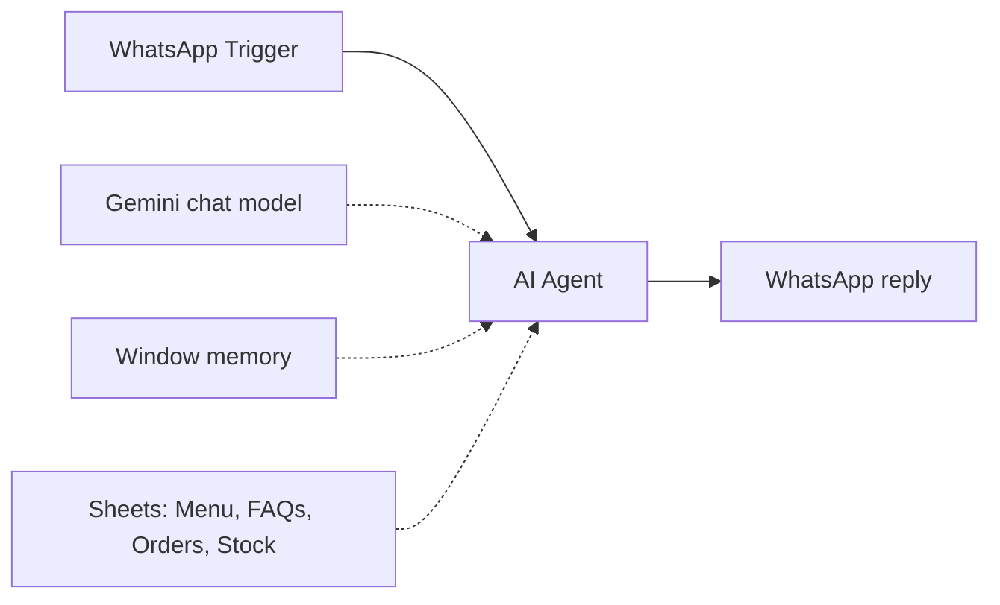

# WhatsApp Restaurant Ordering Agent

A WhatsApp agent for a restaurant. It shows the menu, answers common questions, takes orders and updates stock, with all data kept in Google Sheets.

## How it works

1. The WhatsApp Trigger receives a customer message.
2. The AI Agent (Gemini with window memory) uses four Google Sheets tools:
   - read the menu
   - read FAQs
   - append an order
   - update stock
3. The reply is sent back on WhatsApp.

## Integrations

- WhatsApp Cloud API
- Google Gemini
- Google Sheets (4 tools)

## Setup

1. Import `workflow.json` into n8n.
2. Create credentials for WhatsApp (trigger and send), Google Gemini and Google Sheets, then select them in the nodes.
3. Replace `{{GOOGLE_SHEET_ID}}` and `{{CONTACT_PHONE_NUMBER}}`. Create the tabs Menu, FAQS, Orders and stock.
4. Edit the agent prompt with your restaurant name ("Demo Restaurant" in the export).

## Possible improvements

- Send an order summary to the kitchen (email, Slack or a second WhatsApp number).
- Refuse orders when an item's stock reaches zero.
