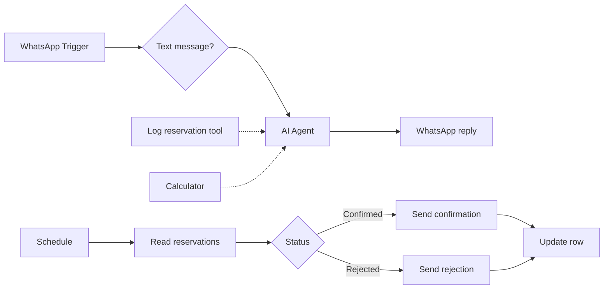

# WhatsApp Restaurant Reservation Agent

Takes table reservations on WhatsApp and logs them in Google Sheets. A second branch reads the sheet and tells each guest whether their booking was confirmed or rejected.

Built on an n8n community template and extended with custom prompts and integrations.

## How it works

1. Incoming WhatsApp text messages go to an AI Agent (Gemini with window memory).
2. The agent collects name, date, time slot and party size. It logs the reservation in Google Sheets and uses a calculator tool for discounts.
3. The reply is sent on WhatsApp.
4. On a schedule, the workflow reads the reservations sheet. Staff set the Status column to "Confirmed" or "Rejected".
5. The guest gets a confirmation or rejection message, and the row is updated so it is not sent again.

## Integrations

- WhatsApp Cloud API
- Google Gemini, Calculator tool
- Google Sheets

## Setup

1. Import `workflow.json` into n8n.
2. Create credentials for WhatsApp (trigger and send), Google Gemini and Google Sheets, then select them in the nodes.
3. Replace these placeholders: `{{WHATSAPP_PHONE_NUMBER_ID}}`, `{{GOOGLE_SHEET_ID}}`, `{{CONTACT_PHONE_NUMBER}}`, `{{MENU_IMAGE_URL}}`, `{{RESTAURANT_MAPS_URL}}`.
4. Set the interval in the Schedule Trigger (it is left at the default).

## Possible improvements

- Check table capacity before accepting a reservation.
- Add a "Notified" column so the status check does not depend on text matching.
