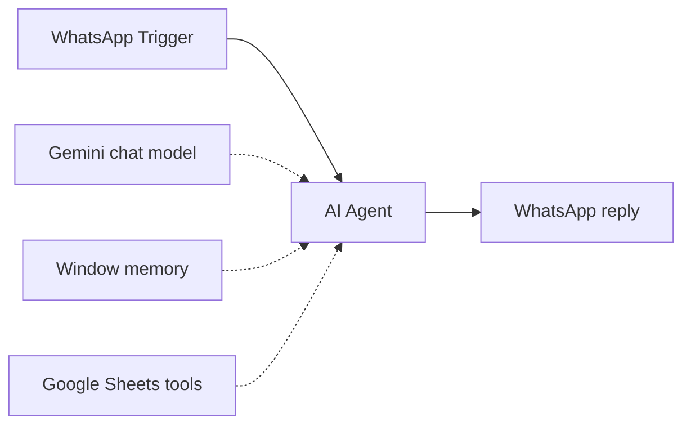

# WhatsApp Salon Booking Agent

An AI receptionist for a hair salon on WhatsApp. It answers questions about services, opening hours and stylists, and it books, updates or cancels appointments in Google Sheets.

## How it works

1. The WhatsApp Trigger receives a customer message.
2. The AI Agent (Gemini with window memory) follows a receptionist prompt. It uses seven Google Sheets tools:
   - salon services and prices
   - opening hours
   - stylist suggestions and stylist details
   - create booking, get booking details, update booking
3. The reply is sent back to the customer on WhatsApp.

## Integrations

- WhatsApp Cloud API
- Google Gemini
- Google Sheets (7 tools)

## Setup

1. Import `workflow.json` into n8n.
2. Create credentials for WhatsApp (trigger and send), Google Gemini and Google Sheets, then select them in the nodes.
3. Replace the placeholder `{{GOOGLE_SHEET_ID}}`. Create the tabs: order booking, suggest stylist, opening hours, services, stylist details.
4. Edit the prompt with your salon name and policies.

## Possible improvements

- Check stylist availability before confirming a booking.
- Send a reminder message the day before the appointment.
