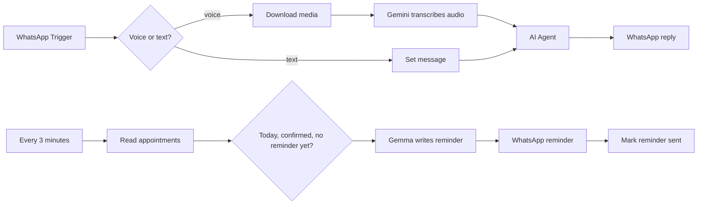

# WhatsApp Voice Appointment Setter

A WhatsApp assistant that books, moves and cancels appointments. It understands text and voice notes, keeps Google Calendar and Google Sheets in sync, sends email confirmations, and sends reminders on the day of the appointment.

## How it works

1. The WhatsApp Trigger receives a message. A Switch checks the message type.
2. Voice notes are downloaded and transcribed with Gemini 2.5 Flash. Text messages go straight to the agent.
3. The AI Agent (Gemini chat model with window memory) talks to the customer. It has these tools:
   - Google Calendar: read, create and delete events
   - Google Sheets: read, add and update appointment rows
   - Gmail: send confirmations
4. The agent's reply is sent back on WhatsApp.
5. Every 3 minutes a schedule reads the appointment sheet. It finds confirmed appointments for today that have no reminder yet.
6. Gemma 3n writes a short reminder that includes the appointment date and converts the time to the customer's time zone. The reminder is sent on WhatsApp and the row is marked "Reminder Sent".

## Integrations

- WhatsApp Cloud API
- Google Gemini 2.5 Flash (chat and audio transcription), Gemma 3n
- Google Calendar, Google Sheets, Gmail

## Setup

1. Import `workflow.json` into n8n.
2. Create credentials for WhatsApp (trigger and send), Google Gemini, Google Calendar, Google Sheets and Gmail. Select them in the nodes.
3. Replace these placeholders: `{{WHATSAPP_PHONE_NUMBER_ID}}`, `{{WHATSAPP_ACCESS_TOKEN}}`, `{{RECIPIENT_PHONE_NUMBER}}`, `{{CONTACT_PHONE_NUMBER}}`, `{{GOOGLE_CALENDAR_ID}}`, `{{GOOGLE_SHEET_ID}}`, `{{BCC_EMAIL}}`.
4. In the agent and reminder prompts, replace `{{TIMEZONE}}` with your business time zone (for example "Central European Time") and `{{SENDER_NAME}}` with the name that signs reminders. These sit inside n8n expressions, so the workflow will fail until they are replaced.
5. Create an "Appointments" sheet with these columns: Name, Phone, Email, Appointment Date, Time Zone, Intake Form, Booking Status, Reminder Sent.
6. Edit the agent's system prompt with your business hours and services.

## Possible improvements

- Store the time zone and sender name in one Set node instead of inside the prompts.
- Use the WhatsApp credential in the media download request instead of a token placeholder.
- Run the reminder check less often, or only during business hours.
