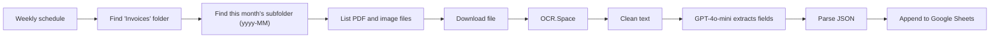

# Invoice OCR Extraction to Sheets

Reads invoices from a monthly Google Drive folder every week. It runs OCR on each file, uses GPT-4o-mini to turn the text into structured fields, and adds one row per invoice to Google Sheets.

Built on an n8n community template and extended with English invoice localisation, monthly folder lookup and structured GPT extraction.

## How it works

1. A schedule runs every Monday.
2. Google Drive search finds the `Invoices` folder, then the subfolder for the current month (for example `2026-10`).
3. Every PDF or image file in that folder is downloaded.
4. OCR.Space reads the text (English). A Code node removes noise and extra whitespace.
5. GPT-4o-mini returns JSON with invoice date, due date, client name, subtotal, tax, total, bank details and line items. A Code node parses it.
6. Each invoice is appended as a row, with a link to the file, to a sheet tab named after the month folder (fallback: "Invoice Ledger").

## Integrations

- Google Drive, Google Sheets
- OCR.Space API
- OpenAI GPT-4o-mini

## Setup

1. Import `workflow.json` into n8n.
2. Create credentials for Google Drive, Google Sheets and OpenAI, then select them in the nodes.
3. Get a free OCR.Space API key and replace `{{OCR_SPACE_API_KEY}}`. Replace `{{GOOGLE_SHEET_ID}}`.
4. In Drive, create `Invoices/<yyyy-MM>/` and add invoices. Create a matching `yyyy-MM` tab in the sheet.

## Possible improvements

- Skip files that were already processed (store file IDs in the sheet).
- Use the OpenAI structured output option instead of parsing JSON in code.
