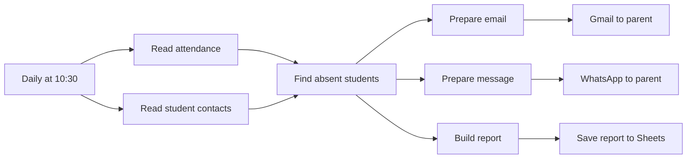

# Student Absence Alerts and Reports

Checks school attendance every morning, finds absent students, and alerts their parents by email and WhatsApp. The alert level depends on how often the student was absent in the last 30 days. A daily report is saved to Google Sheets.

## How it works

1. A schedule runs at 10:30 every day and reads the attendance and student contact sheets.
2. A Code node finds students marked "Absent". It counts their absences in the last 30 days and sets an alert level.
3. Parents receive an email (Gmail) and a WhatsApp message (WhatsApp Cloud API over HTTP).
4. A summary report for the day is appended to Google Sheets.

## Integrations

- Google Sheets
- Gmail
- WhatsApp Cloud API (HTTP request)

## Setup

1. Import `workflow.json` into n8n.
2. Create credentials for Google Sheets and Gmail, then select them in the nodes.
3. Replace these placeholders: `{{GOOGLE_SHEET_ID}}`, `{{SCHOOL_EMAIL}}`, `{{WHATSAPP_PHONE_NUMBER_ID}}`, `{{WHATSAPP_ACCESS_TOKEN}}`.
4. The attendance sheet needs Student ID, Date and Status columns. The contacts sheet needs Student ID, parent email and phone.

## Possible improvements

- Use the WhatsApp node with a credential instead of a token in the HTTP header.
- Skip weekends and school holidays.
