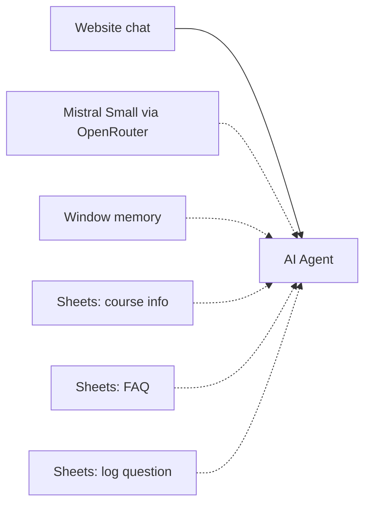

# Website Course FAQ Chatbot

A chat widget for a course website. The agent answers questions about courses and common topics from Google Sheets. When it cannot answer, it asks for the visitor's mobile number and logs the question so the team can call back.

Built on an n8n community template and extended with custom prompts and integrations.

## How it works

1. The n8n chat trigger receives a question from the website widget.
2. The AI Agent (a "Course Assistant" prompt, Mistral Small 24B via OpenRouter, window memory) looks up course details and FAQs in Google Sheets. It replies in the visitor's language (English, Hindi or Roman English).
3. If the answer is not in the sheets, the agent asks for a mobile number and saves the question and number to the "Unanswered Queries" sheet.

## Integrations

- n8n Chat Trigger (embeddable widget)
- OpenRouter (Mistral Small 24B)
- Google Sheets (3 tools)

## Setup

1. Import `workflow.json` into n8n.
2. Create credentials for OpenRouter and Google Sheets, then select them in the nodes.
3. Replace `{{GOOGLE_SHEET_ID}}`. Create tabs for course info, FAQ and "Unanswered Queries".
4. Make the chat trigger public and embed it on your site with the n8n chat widget.

## Possible improvements

- Send the team a notification when a new unanswered question is logged.
- Move to a vector store if the FAQ grows large.
