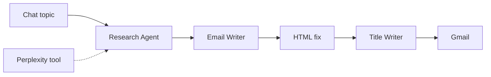

# AI News Research Newsletter Agent

Type a topic in chat and receive a finished HTML newsletter by email. One agent researches the latest news with Perplexity, a second writes the newsletter, and a third writes the subject line.

## How it works

1. The user enters a topic in the n8n chat.
2. The Research Agent uses Perplexity (news from the last week) to collect facts and sources.
3. The Email Writer agent, prompted as an experienced tech newsletter editor, turns the research into an HTML newsletter.
4. An HTML node cleans the markup, and the Title Writer agent creates a subject line.
5. The newsletter is sent with Gmail.

All three agents use chat models through OpenRouter.

## Integrations

- n8n Chat Trigger
- OpenRouter (chat models), Perplexity
- Gmail

## Setup

1. Import `workflow.json` into n8n.
2. Create credentials for OpenRouter, Perplexity and Gmail, then select them in the nodes.
3. Choose a model in each OpenRouter node.
4. Replace the placeholder `{{RECIPIENT_EMAIL}}`.

## Possible improvements

- Read a list of subscribers from a sheet instead of one recipient.
- Run on a weekly schedule with a fixed list of topics.
