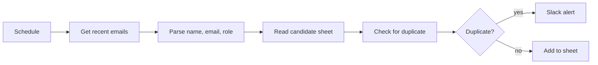

# Gmail Duplicate Candidate Detector

Watches Gmail for job applications and checks each candidate against a Google Sheet. New candidates are added to the sheet; duplicates are reported in Slack.

## How it works

1. A schedule trigger runs every minute and fetches emails received in the last 10 minutes.
2. A Code node parses the candidate name, email and role from the email.
3. The candidate sheet is read and a second Code node compares email addresses (case-insensitive).
4. Duplicates are sent to Slack. New candidates are added to the sheet.

## Integrations

- Gmail
- Google Sheets
- Slack

## Setup

1. Import `workflow.json` into n8n.
2. Create credentials for Gmail, Google Sheets and Slack, then select them in all nodes.
3. Replace `{{GOOGLE_SHEET_ID}}` and `{{SLACK_USER_ID}}`.
4. Make sure the sheet has a `candidate_email` column.

## Possible improvements

- Process every email in a run (the code currently handles only the first one).
- Filter Gmail by a label or subject so only applications are read.
