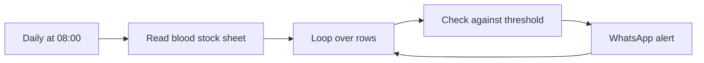

# Blood Bank Low Stock Alerts

Checks blood stock levels in Google Sheets every morning and sends a WhatsApp alert for each blood group that is below its threshold.

## How it works

1. A Cron trigger runs every day at 08:00.
2. The stock sheet is read and each row is processed in a loop.
3. A Code node compares units with the threshold (default 10 units) and formats the last-updated date.
4. For each low blood group, a WhatsApp message is sent to the contact number.

## Integrations

- Google Sheets
- WhatsApp Cloud API

## Setup

1. Import `workflow.json` into n8n.
2. Create credentials for Google Sheets and WhatsApp, then select them in the nodes.
3. Replace `{{GOOGLE_SHEET_ID}}` and `{{CONTACT_PHONE_NUMBER}}`.
4. The sheet needs a blood group, units, optional threshold, and last updated columns.

## Possible improvements

- Upgrade the legacy Cron and Google Sheets v2 nodes to the current versions.
- Send one summary message instead of one message per blood group.
