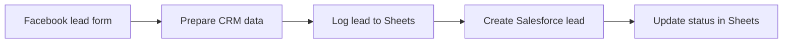

# Facebook Lead Ads to Salesforce Sync

Sends every new Facebook Lead Ads lead to Google Sheets and Salesforce. The sheet keeps a log and records whether the lead was created in the CRM.

Built on an n8n community template and extended with custom prompts and integrations.

## How it works

1. The Facebook Lead Ads trigger fires when someone submits the lead form.
2. A Set node splits the lead's full name into first and last name for Salesforce.
3. The lead is logged in Google Sheets.
4. A Lead is created in Salesforce, and the sheet row is updated with the result.

## Integrations

- Facebook Lead Ads
- Google Sheets
- Salesforce

## Setup

1. Import `workflow.json` into n8n.
2. Create credentials for Facebook Lead Ads, Google Sheets and Salesforce, then select them in the nodes.
3. Replace these placeholders: `{{FACEBOOK_PAGE_ID}}`, `{{FACEBOOK_FORM_ID}}`, `{{GOOGLE_SHEET_ID}}`, `{{SHEET_NAME}}`.

## Possible improvements

- Remove the legacy Start node and update older node versions.
- Check Salesforce for an existing lead before creating a new one.
- Add a Google Ads lead form trigger as a second source.
