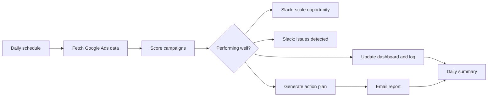

# Google Ads PPC Performance Monitor

Checks Google Ads campaigns every day, scores their performance, logs the results to Google Sheets, alerts Slack about campaigns to scale or fix, and emails an action plan.

Built on an n8n community template and extended with custom prompts and integrations.

## How it works

1. A schedule trigger runs every 24 hours.
2. The Google Ads node pulls campaign metrics (impressions, clicks, cost, conversions).
3. A Code node calculates CTR, conversion rate, cost per conversion and average CPC. It then gives each campaign a score, insights and recommendations.
4. An If node splits strong campaigns from weak ones.
5. All campaigns are written to a dashboard sheet and a log sheet. Slack gets a "scale" or "issue" alert.
6. A Code node builds an action plan, which is emailed over SMTP. A summary item closes the run.

## Integrations

- Google Ads
- Google Sheets
- Slack
- SMTP email

## Setup

1. Import `workflow.json` into n8n.
2. Create credentials for Google Ads, Google Sheets, Slack and SMTP, then select them in the nodes.
3. Replace these placeholders: `{{GOOGLE_SHEET_ID}}`, `{{SENDER_EMAIL}}`, `{{RECIPIENT_EMAIL}}`, `{{REPLY_TO_EMAIL}}`.
4. Set the Google Ads customer ID and choose the Slack channels.

## Possible improvements

- The "AI Performance Analysis" node is rule-based code. An LLM step could add written insights.
- Store the score thresholds in one config node.
