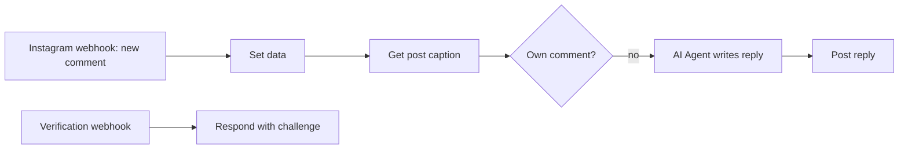

# Instagram Comment Auto-Reply Agent

Replies to new Instagram comments automatically. It reads the post caption for context, skips comments made by your own account, and posts a short AI-written reply.

Built on an n8n community template and extended with an English prompt and an own-comment filter.

## How it works

1. A GET webhook answers Meta's verification request when you subscribe the app.
2. A POST webhook (`/instagram-comments`) receives each new comment event.
3. The workflow fetches the post caption from the Instagram Graph API.
4. A filter compares the commenter ID with your account ID and skips your own comments, so the bot never replies to itself.
5. An AI Agent (Gemini 2.0 Flash via OpenRouter) writes a short, friendly reply in English using the caption as context.
6. The reply is posted under the comment through the Graph API.

## Integrations

- Instagram Graph API (webhooks and HTTP)
- OpenRouter (Google Gemini 2.0 Flash)

## Setup

1. Import `workflow.json` into n8n.
2. Create an OpenRouter credential and a Header Auth credential with your Instagram access token. Select them in the agent model and the HTTP nodes.
3. In your Meta app, subscribe to Instagram `comments` and use the webhook URL from n8n (`/instagram-comments`) for both verification and events.

## Possible improvements

- Log comments and replies to a sheet for review.
- Skip or flag comments that contain complaints so a person can answer them.
