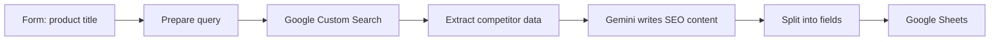

# Product Research and SEO Content Generator

Enter a product title in a form. The workflow searches Google for competing products, then Gemini writes SEO metadata and product copy based on what it found. The result is saved to Google Sheets.

Built on an n8n community template and extended with custom prompts and integrations.

## How it works

1. An n8n form collects the product title.
2. The title is turned into a query for the Google Custom Search API.
3. A Function node extracts competitor titles, snippets and keywords from the results.
4. A Gemini 2.0 Flash chain writes an SEO title, meta description, keywords, and a product title and description.
5. A Code node splits the text into separate fields, and the row is added or updated in Google Sheets.

## Integrations

- n8n Form Trigger
- Google Custom Search JSON API
- Google Gemini 2.0 Flash
- Google Sheets

## Setup

1. Import `workflow.json` into n8n.
2. Create credentials for Google Gemini and Google Sheets, then select them in the nodes.
3. Create a Programmable Search Engine and API key. Replace `{{GOOGLE_SEARCH_API_KEY}}` and `{{GOOGLE_SEARCH_CX}}`.
4. Replace `{{GOOGLE_SHEET_ID}}` and `{{SHEET_NAME}}`.

## Possible improvements

- Replace the legacy Function node with a Code node.
- Ask the model for JSON output with a structured parser instead of parsing free text.
