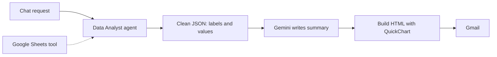

# AI Data Analyst Chart Reports

Ask a question about your sales data in chat. An AI agent reads the Google Sheet, picks the numbers, and the workflow emails a report with line, bar and pie charts and a written summary.

## How it works

1. The user asks a question in the n8n chat, for example "sales by product this month".
2. The Data Analyst agent (Gemini with window memory) reads the sheet and returns labels and values as JSON.
3. A Code node cleans and parses the JSON.
4. Gemini 2.5 Flash writes a short summary: totals, average, best and worst items.
5. A Code node builds QuickChart image URLs for line, bar and pie charts and puts them in an HTML email.
6. The report is sent with Gmail.

## Integrations

- n8n Chat Trigger
- Google Gemini 2.5 Flash
- Google Sheets, Gmail
- QuickChart (chart images by URL)

## Setup

1. Import `workflow.json` into n8n.
2. Create credentials for Google Gemini, Google Sheets and Gmail, then select them in the nodes.
3. Replace `{{GOOGLE_SHEET_ID}}` and `{{RECIPIENT_EMAIL}}`.

## Possible improvements

- Let the user pass the recipient email in the chat.
- Use a structured output parser on the agent instead of cleaning JSON in code.
