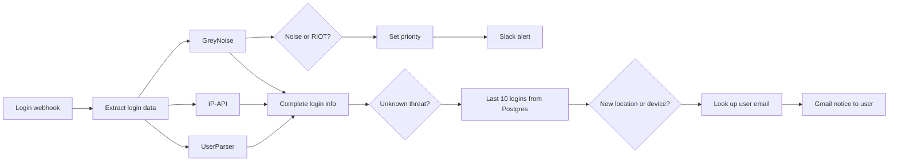

# Suspicious Login Detection

Checks every login event for signs of risk. It enriches the IP address and user agent, compares them with the user's recent logins, sends a prioritised alert to Slack, and emails the user when a new location or device is seen.

Built on an n8n community template and extended with custom prompts and integrations.

## How it works

1. A `POST /login-event` webhook receives a login event (Segment-style `track` payload). A manual trigger with an example event is included for testing.
2. The IP and user agent are extracted and sent in parallel to GreyNoise (threat intel), IP-API (geolocation) and UserParser (device and browser).
3. GreyNoise results are classified (malicious, benign, unknown, RIOT trust level) and mapped to a HIGH, MEDIUM or LOW priority, which is posted to Slack.
4. If the IP is not a known threat, the workflow loads the user's last 10 logins from Postgres and checks whether the location or device/browser is new.
5. For a new location or device, it looks up the user's email in Postgres and sends an HTML notice via Gmail.

## Integrations

- Webhook, Postgres
- GreyNoise Community API, IP-API, UserParser API
- Slack, Gmail

## Setup

1. Import `workflow.json` into n8n.
2. Create credentials for Postgres, Slack, Gmail and the UserParser API key, then select them in the matching nodes.
3. Replace these placeholders:
   - `{{DB_SCHEMA}}`: schema that holds the `user_signed_in` and `users` tables
   - `{{SLACK_CHANNEL}}`: channel for alerts
   - `{{APP_HOST}}`, `{{APP_NAME}}`, `{{EXAMPLE_USER_ID}}`, `{{INTERNAL_IP}}`, `{{PROXY_SERVER_ID}}`: only used in the example event
4. Point your app's login events to the webhook URL, then activate the workflow.

## Possible improvements

- Use a geolocation provider over HTTPS (the free IP-API endpoint is HTTP only).
- Store each enriched login back in Postgres to build history without a separate tracking pipeline.
- Add impossible-travel detection (distance and time between consecutive logins).
